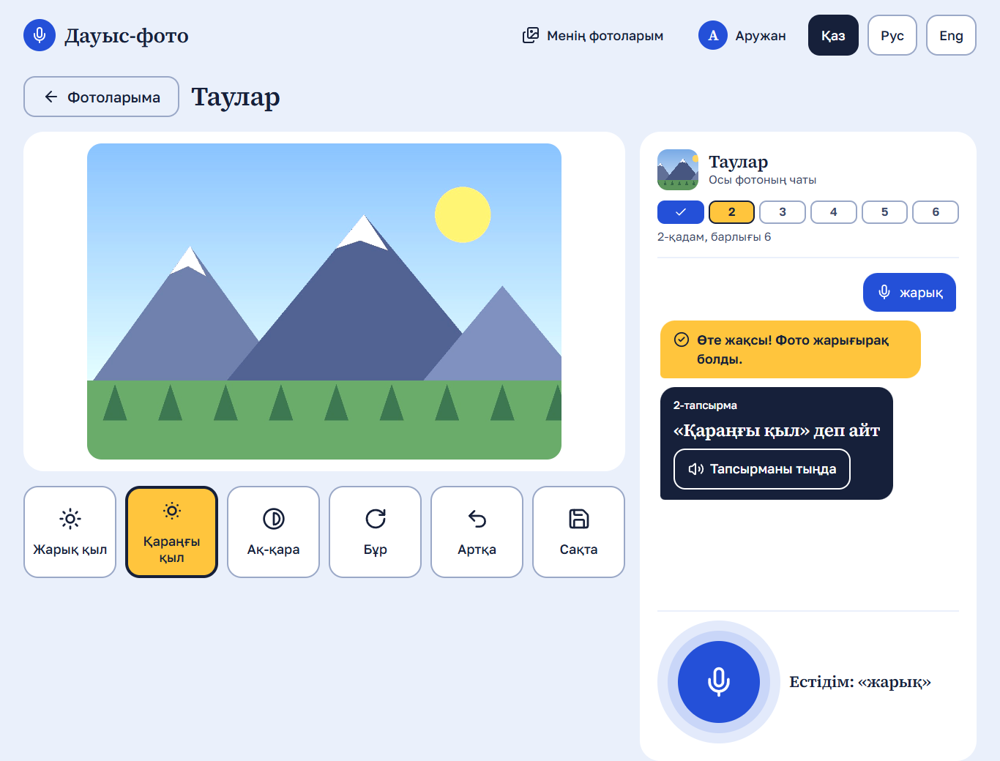

# Dauys-Foto (Дауыс-фото)

A voice user interface that teaches children with **dyspraxia** to use basic photo
editing tools. Dyspraxia makes small targets, dragging and precise clicks hard,
while thinking is unaffected. So the app is driven by voice, and every action
also has a very large button as a fallback.

The interface, voice commands, speech recognition and spoken feedback work in
**Kazakh (default), Russian and English**. Everything is free and runs locally;
after the first setup no internet connection is needed.

University HCI coursework project.



## What a child does

1. Signs up (name, username, password twice) or logs in.
2. Picks one of their photos. Three sample scenes (mountains, sea, city) are
   ready for every new user; they can also upload their own.
3. Hears and reads a task, for example «Жарық қыл» деп айт, presses the big
   microphone once and says the command. Pressing the matching tile works too,
   and so do Tab and Enter.
4. After the first request a chat slides in. The assistant praises, explains
   what it heard, and gives the next task. Six steps: brighten, darken,
   black and white, undo, rotate, save.
5. After the sixth step: before/after photos, the words learned, and free mode.

Each child sees only their own photos and chats; the chat is saved per photo.

## Architecture

```
Browser (React + TypeScript, Vite)               Backend (Django + DRF, SQLite)
──────────────────────────────────               ───────────────────────────────
voice/   microphone → 16 kHz WAV ───────────────▶ speech/  Vosk, grammar = command phrases
editor/  canvas pixel operations + undo           photos/  upload, edited versions
chat/    message list, bubbles                    chats/   messages, lesson progress,
lesson/  task card, step bar, finish view  ◀────────────── rule-based assistant.reply()
auth/    JWT login, auto token refresh   ◀──────▶ accounts/ register, login, profile
```

- **Frontend** (`frontend/src`): `app/` (router, layout), `pages/`, `features/`
  (auth, voice, editor, chat, lesson, photos), `shared/` (UI components, HTTP
  client, translations, design tokens). State: React state and one small
  `zustand` store for the session. Styles: CSS Modules. Animation: `motion`.
- **Backend** (`backend/`): one Django app per area. Every query is filtered by
  the logged-in user (`photos_of(request.user)`); another user's photo returns
  404. Tests prove it.
- **One command registry.** Command ids live in
  `frontend/src/features/editor/commands.ts`; the words for them in each
  language live in `frontend/src/shared/i18n/*.json` and
  `backend/speech/phrases/*.py`. A backend test fails if the two lists differ.
- **Editing happens in the browser.** Pixel operations are pure functions
  (`engine.ts`), so undo just keeps earlier bitmaps. “Save” uploads the result
  as the photo's new version and offers a download.
- **The assistant is rule-based** (`backend/chats/assistant.py`): templates
  with variations, no external AI. It sits behind one function,
  `reply(command, lesson_state, lang)`, so a language model could replace it
  without changing the views or the UI.

## How speech recognition works

Browser speech recognition is unreliable for Kazakh, so recognition runs on the
backend with [Vosk](https://alphacephei.com/vosk/), a free offline engine.

1. One press on the microphone starts listening. The browser captures audio with
   the Web Audio API (an `AudioWorklet`), measures loudness, and stops by itself
   after about 1.5 s of silence following speech, or after 6 s, or on a second
   press. Nobody has to hold a button.
2. The audio is downsampled to 16 kHz mono and encoded as a 16-bit PCM WAV in
   JavaScript (`features/voice/wav.ts`), so the backend reads it with Python's
   `wave` module. **No ffmpeg is needed.**
3. `POST /api/speech/recognize/` runs Vosk with a **grammar**: only the command
   phrases of that language plus `[unk]`. Restricting the vocabulary makes
   recognition much more accurate, which matters for children's voices.
   Every phrase was checked against the model vocabulary.
4. The response is `{ "text": "...", "command": "grayscale" | null }`.

Models (small, ~40–60 MB each): `vosk-model-small-kz-0.42`,
`vosk-model-small-ru-0.22`, `vosk-model-small-en-us-0.15`. Each is loaded once,
on first use, and then reused.

Spoken feedback uses the browser's free `speechSynthesis` with a voice for the
current language.

## Setup on Windows (PowerShell)

Requirements: Python 3.11+, Node.js 20+, Git. All commands run from the project root.

```powershell
# 1. Backend: virtual environment and packages
python -m venv .venv
.\.venv\Scripts\python.exe -m pip install -r backend\requirements.txt

# 2. Settings: copy the example and put a long random value in DJANGO_SECRET_KEY
Copy-Item .env.example .env

# 3. Database and speech models (about 150 MB download, once)
.\.venv\Scripts\python.exe backend\manage.py migrate
.\.venv\Scripts\python.exe backend\scripts\download_models.py

# 4. Frontend packages
npm --prefix frontend install
```

New users get the sample photos automatically. For users created before (for
example with `createsuperuser`), run
`.\.venv\Scripts\python.exe backend\manage.py seed_sample_photos`.

## Run

Two terminals, both in the project root:

```powershell
# Terminal 1: backend on http://localhost:8000
.\.venv\Scripts\python.exe backend\manage.py runserver 8000
```

```powershell
# Terminal 2: frontend on http://localhost:5173
npm --prefix frontend run dev
```

Open http://localhost:5173. Vite forwards `/api` and `/media` to Django, so the
browser sees one origin.

## Tests and linters

```powershell
# Backend: auth, ownership isolation, assistant, speech endpoint (recogniser mocked)
.\.venv\Scripts\python.exe backend\manage.py test accounts photos chats speech
.\.venv\Scripts\python.exe -m ruff check backend
.\.venv\Scripts\python.exe -m ruff format --check backend

# Frontend: command matching, canvas engine, WAV encoding, silence detection
npm --prefix frontend test
npm --prefix frontend run lint
npm --prefix frontend run format:check
npm --prefix frontend run typecheck
```

Run the backend tests from the project root as shown, or `manage.py test` from
inside `backend\`.

## Design rules from dyspraxia

- Targets at least 56 px high, tiles at least 96 px, microphone 112 px, 12 px
  between targets.
- No drag and drop, double click, hover-only actions, sliders, press-and-hold,
  tiny close icons, or typing after login (profile settings are buttons only).
- Nothing is timed against the child; messages stay until the situation changes.
- Every edit can be undone. Errors are never red and never blame the child.
- Every command works by voice, tile click, and keyboard (Tab + Enter).
- Animations are short and soft; under `prefers-reduced-motion` only fades remain.

## Known limitations

- **Kazakh spoken feedback:** most computers have no Kazakh voice for
  `speechSynthesis`. Then the app stays silent (it does not read Kazakh with a
  Russian voice) and the child relies on the text on screen.
- **Recognition is limited to commands on purpose.** Free speech is reported as
  “not a command”, so the assistant cannot quote exactly what a child said
  when it was not a command.
- Recognition was tested with synthesized voices and a fake microphone, not
  with real children. Accuracy for children's voices still needs user testing.
- **Windows and non-Latin paths:** Vosk cannot open models in a folder whose
  path has non-Latin letters. The backend passes the short 8.3 path instead;
  if that is disabled on a machine, set `VOSK_MODELS_DIR` in `.env` to a Latin
  path and run the download script again.
- The development servers are meant for local use only; there is no production
  deployment setup.
- The JavaScript bundle is about 550 kB (175 kB gzipped); code splitting was
  not needed for local use.
